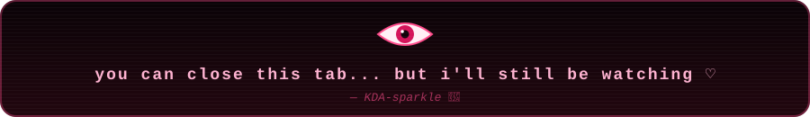

  

  

  
  
  

## 🌸 Who's hiding behind the smile?

- 🎀 **Pronouns:** She/Her
- 💼 **Role:** Freelance developer: web, desktop, mobile and bots
- 🔪 **Dev personality:** front-end glitter, back-end control freak
- 💖 **Fixations:** anime, gaming, cybersecurity, UI/UX, and anything that can be made <b>too</b> cute
- 🎮 **Favorite games:** Neverness to Everness, Honkai Star Rail, Valorant
- 🍀 **Hobbies:** coding, drawing, streaming, cosplay... and silently watching your commits

## 🩸 What I'm obsessed with right now

### 🎬 [ClipVault](https://valyrix.eu)

Capture, library, editing and sharing of game clips, for **Windows and Linux**, with an **Android companion app** that drives the PC remotely.

  
  
  
  

Electron + React desktop app, Fastify server, React Native (Expo) mobile app, and a native C# module for per-process audio capture.
➡️ [Download](https://github.com/KDA-sparkle/clipvault-releases/releases/latest) · [Website](https://valyrix.eu)

### 🎀 [Fediverse CSS themes](https://github.com/KDA-sparkle/css.a.fedi.catboy.agency)

**Astolfo** and **Yandere** themes for Misskey / Sharkey (fedi.catboy.agency), one `@import` away.

### 📛 [All GitHub badges](https://github.com/KDA-sparkle/all-github-badge)

A cheat sheet of shields.io badges for your READMEs.

## 🗡️ Weapons of choice

  
  
  
  
  
  
  
   
  
  
  
  
  
  
   
  
  
  
  
  

## 📊 Obsession Stats

  <!-- Languages % computed automatically across all repos, private ones included (lowlighter/metrics) -->
  

  

  

  

## ⚠️ Yandere Warnings

> [!CAUTION]
> - I know when you scroll too fast.
> - I know when you stare at my stats without leaving a star.
> - If you code at 3 AM... we are already pair-programming.

## 🕷️ Web of Links

  
  
  
  
  

  

